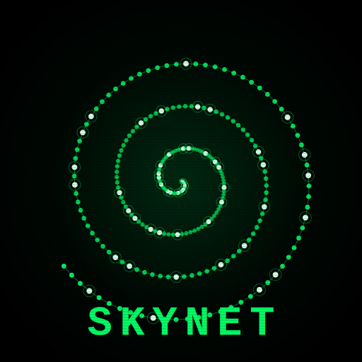

<div align="center">



# SkyNet

**Автономный агент, который выживает на ретро-железе.**

Один исходник · два модуля · ноль зависимостей · ноль плавающей точки

`M0` — ядро готово, 37/37 инварианта, 2.29 млн простых без единого расхождения,
**и оно работает на настоящем 16-битном DOS**

[](../../actions/workflows/ci.yml)

</div>

---

## Что это

SkyNet — программа, которая:

- **сама принимает решения** на основе собственной генерации мыслей;
- **сама дообучается** и улучшает свой исходник под контролем fitness;
- **работает на 8088 и на x86_64** из одного и того же кода;
- **не теряет состояние** при сбое — ни при убийстве процесса, ни при пропадании питания;
- **деградирует, а не падает** при нехватке памяти.

Название смелое. Задача — не «AGI», а измеримая вещь: система, которую можно
отправить в космос на 50 лет и которая вернётся с работающим состоянием.

## Логотип

Эмблема не нарисована — она **вычислена**. Узлы спирали — это простые числа,
яркие с кольцом — сверхпростые (A006450: 3, 5, 11, 17, 31, 41, 59, 67, 83, 109…).
То есть логотип буквально изображает Prime Clock, который эта программа
использует как единственный источник времени.

```bash
python tools/make_logo.py     # перегенерировать из простых чисел
```

## Быстрый старт

```powershell
# собрать и проверить всё одной командой
.\build.ps1 -Compiler all -RunTests

# или вручную
gcc -std=c89 -pedantic -Wall -Wextra -O2 -o skynet.exe ^
    src\main.c src\sk_math.c src\sk_arena.c src\sk_clock.c ^
    src\sk_vault.c src\sk_sched.c src\sk_io.c src\sk_selftest.c

# проверить себя
skynet selftest                # 34/34

# погонять простые с чекпоинтами
skynet run --max 1000000

# что будет восстановлено после сбоя
skynet recover

# краш-тест: убивает процесс N раз и проверяет непрерывность
powershell -File tests\crash_test.ps1 -Rounds 15
```

## Три решения, на которых всё держится
### 1. Prime Clock — единственное время

Не RTC, не тики, не `time()`. Индекс простого числа монотонен, воспроизводим
и проверяется одной строкой арифметики. Каждое **сверхпростое** — точка
чекпоинта, самопроверки и перебалансировки планировщика.

Машина, которая должна работать 50 лет, не может доверять часам, которые
дрейфуют, и не может резюмиться «с тика 9 999 999 999», потому что это число
зависит от того, насколько быстрым был предыдущий процессор.

### 2. Никаких потоков

DOS их не имеет. Кооперативные шаги дают три вещи, которых не даст ни один
поток в 640 КБ:

- **детерминизм** — один такт, один порядок, один результат;
- **отсутствие гонок** — нечего терять в году 40;
- **жёсткий контроль памяти** — планировщик паркует задачу при перерасходе.

### 3. Деградация вместо падения

Арена возвращает `NULL`, планировщик паркует задачу, агент теряет качество —
но продолжает жить. На 640 КБ это разница между «работает грубо» и
«не запустилось».

## Структура

```
SkyNet/
├── src/                ядро M0, strict C89, ~1900 строк
│   ├── sk_types.h      базовые типы, Q16.16
│   ├── sk_math.c       π/e/√2/ln2 выводятся формулами, xoshiro128**, CRC32C
│   ├── sk_arena.c      bump-аллокатор с mark/release
│   ├── sk_clock.c      сегментное решето, Prime Clock
│   ├── sk_vault.c      A/B слоты + WAL + CRC32C
│   ├── sk_sched.c      кооперативные шаги, governor памяти
│   └── sk_io.c         единственное место с #ifdef под платформы
├── tests/              краш-тест и судья
├── tools/              генератор логотипа
├── docs/               рассуждения — это часть результата
├── assets/             логотип и иконка
└── refs/               материалы (Tiny-2.1, ZMath.cs, Babel.cs)
```

## Документация

| Файл | О чём |
|---|---|
| [docs/00-index.md](docs/00-index.md) | навигация |
| [docs/01-architecture.md](docs/01-architecture.md) | архитектура, инварианты, вехи |
| [docs/02-ci.md](docs/02-ci.md) | что CI ловит и какие баги уже нашёл |
| [docs/03-memory.md](docs/03-memory.md) | EMS и как DOS перестаёт быть 64-килобайтным |
| [docs/04-model.md](docs/04-model.md) | загрузка TINY.BIN: float без float, 38-битная арифметика |
| [docs/05-compression.md](docs/05-compression.md) | измеренная кривая сжатия: почему усечение не работает |
| [docs/10-self-training.md](docs/10-self-training.md) | самообучение на ФС: 6 способов убить систему и 6 инвариантов |
| [docs/11-babel.md](docs/11-babel.md) | Вавилонская библиотека: почему данных всегда хватает |
| [docs/20-ideas.md](docs/20-ideas.md) | бэклог идей с привязкой к рискам |

## Замеры, а не обещания

| Метрика | Значение | Как получено |
|---|---|---|
| Selftest | **38/38** | `skynet selftest` |
| 60 000 простых | **0.12 с** | `--ckpt 64`, без fsync |
| Краш-тест | **2 290 249 простых, 0 расхождений** | 15 убийств процесса |
| **16-бит DOS** | **47 КБ `.exe`, 38/38, восстановление работает** | DOSBox, `tests/dos_test.sh` |
| **EMS на DOS** | **15 168 КБ страничной памяти** | `skynet mem` в DOSBox |
| **TINY.BIN на DOS** | **384 КБ в 24 EMS-страницах, CRC MATCH** | `skynet model TINY.BIN` |
| **Forward pass на DOS** | **побитово равен x86_64** | `skynet predict` в DOSBox |
| **Ответы** | **35/35 верных, 36/38 побитово как оригинал** | `tools/ask_accuracy.py` |
| **Сжатие** | **4-бит: 205 КБ при 51.4%** | `tools/compression_curve.py` |
| **
Т
р
е
н
е
р
** | **loss 0.1127 -> 0.0389, 
г
р
а
д
и
е
н
т
 
т
о
ч
е
н
** | `tools/train_check.sh` |
| Компиляторы | gcc, clang, tcc, OpenWatcom (16-бит) | 0 предупреждений при `-Wall -Wextra -pedantic` |
| Цена fsync | **85 мс** против **0.1 мс** работы | `tests/bench_io.c` |

DOS-цифры не «собралось», а «запустилось и проверилось»:

```
[sky] arena: 65280 of 8388608 bytes granted     <- деградация, не отказ
[sky] resumed at prime #20000 = 224737 (seq 55) <- восстановление на DOS
ems   : v4.0  frame 57344h  free 948/1024 pages (15168 KB free)
pool: 48 KB in 3 EMS pages, 6 maps, 287 reads, 194 writes
[sky] weights in EMS: 384 KB in 24 pages        <- модель на 16-бит DOS
[sky] weights crc  load 1B0E71FA  store 1B0E71FA  MATCH
lines: 25000  last value: 287117  mismatches: 0
```

Попросили 8 МБ на машине с 640 КБ, получили 64 КБ, и программа
продолжила работать — это инвариант I6 в действии, а не на словах.
А 15 МБ через EMS означают, что 380 КБ весов Tiny-2.1 влезают с запасом
в 40 раз: потолок в 64 КБ больше не ограничивает модель.

Модель загружается на DOS и даёт **тот же результат**, что и на x86_64:
CRC весов совпадает, а forward pass выдаёт побитово идентичные логиты:

```
DOS : scores -11.1387 -2.5737 11.4118 17.4864 -8.3587 -11.0526 ...
HOST: scores -11.1387 -2.5737 11.4118 17.4864 -8.3587 -11.0526 ...
```

Проверено против **оригинального** кода Tiny-2.1 (`tests/ref_tiny.c` —
это released forward pass, скомпилированный для хоста, а не моя
переписка). Расхождение 0.3–1.2% — это квантование KV-кэша в int8,
которое делает сам оригинал.

А ответы проверяются отдельно, потому что «совпадает с эталоном» и
«отвечает правильно» — разные утверждения:

```
$ skynet ask TINY.BIN "what is 7 times 8"
answer 7 times 8 is 56.

35/35 correct on the documented question list
```

Последняя строка про fsync — причина, по которой durability-политика
вынесена наружу явным флагом `--durable`, а не спрятана внутри библиотеки.

## CI и артефакты

[`.github/workflows/ci.yml`](.github/workflows/ci.yml) гоняет то, что нельзя
проверить на одной машине:

| Job | Что доказывает |
|---|---|
| `build` × 5 | gcc, clang, tcc, mingw, clang/macOS — все с `-Werror` |
| `build-32bit` | 32-битный бинарник **запускается**: selftest + краш-тест |
| `crash-test` | 15 убийств, `--durable`, восстановление после порчи слота |
| `hygiene` | I1/I2/C89 + проверка, что сам чекер умеет падать |
| `dos` | **16-бит `.exe` собирается И запускается в DOSBox** |

Артефакты: `skynet-linux-x86_64`, `-clang`, `-tcc`, `-i386`,
`-windows-x86_64`, `-macos`, `-dos-16bit`.

Ни один job не помечен `continue-on-error`: то, что нельзя проверить,
не должно выглядеть проверенным.

Артефакты после прогона: `skynet-linux-x86_64`, `skynet-linux-clang`,
`skynet-linux-tcc`, `skynet-linux-i386`, `skynet-windows-x86_64`,
`skynet-macos`, `skynet-dos-16bit`.

Отдельно про `build-32bit`: до CI утверждение «`long` ровно 32 бита»
проверялось только **компиляцией**. Теперь оно проверяется **запуском** —
это самое нагруженное допущение во всём коде, и оно заслуживает реального
теста, а не надежды.

## Лицензия

Код — MIT. См. [LICENSE](LICENSE).
Материалы в `refs/` сохраняют свои лицензии (см. `refs/Tiny-2.1-main/DATA_LICENSES.md`).

---

<div align="center">
<sub>Весь код математический. Константы выводятся, а не вписываются.<br>
Инварианты проверяются, а не подразумеваются.</sub>
</div>
